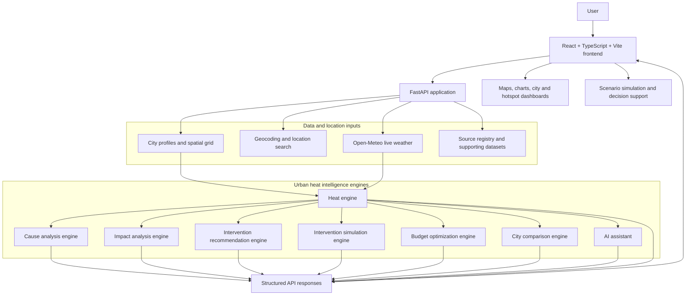
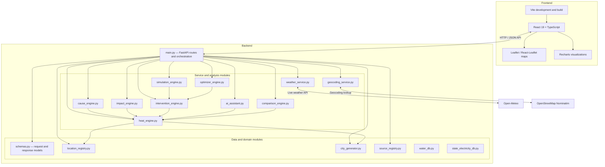

# KAIROS Architecture

This document contains two Mermaid diagrams based on the repository's visible files and the imports/API routes in `main.py`. It describes the architecture represented by the current code; it does not imply that every external dataset or model is independently validated.

## 1. System architecture

## 2. Code architecture

## Main API capabilities

- Health, states, cities, location search, and geocoding
- Live weather and city profile/overview
- Hotspot grids and hotspot cause, impact, and recommendation details
- Energy, water, and heat-health overviews
- Intervention simulation and city-budget optimization
- Multi-city comparison and AI-assisted city queries
- Data-source and metric-provenance metadata

## Repository notes

- The frontend package manifest identifies React, TypeScript, Vite, Leaflet, and Recharts.
- The backend entry point is a FastAPI application in `main.py`.
- The backend entry point imports modules under `backend.models`, `backend.data`, and `backend.services`. Keep the diagram aligned with the actual package paths in the checked-out branch if those directories are reorganized.
- The current root `README.md` is still the default Vite template; replace or expand it with project-specific setup instructions and this architecture document.
